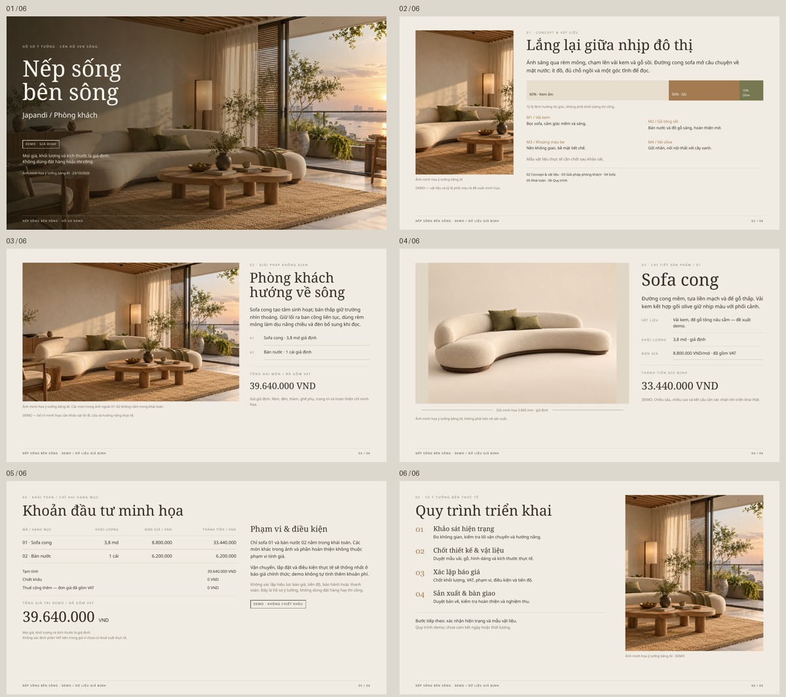
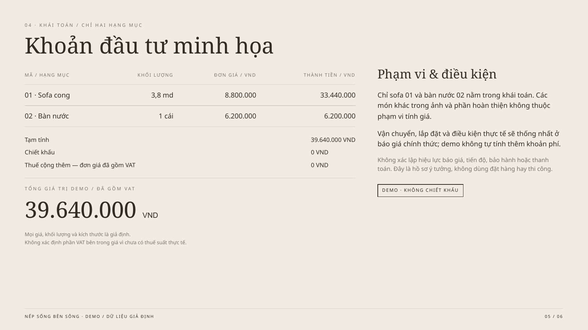

# Interior Proposal PDF

Create polished interior design proposals, furniture catalogues, and illustrated quotations with an AI agent.

**Content → design and consistent AI imagery → paginated HTML → PDF → verification.**

[](https://github.com/caotin/interior-proposal-pdf/actions/workflows/validate.yml)
[](LICENSE)


An [Agent Skill](https://agentskills.io/specification) with English instructions, editable print templates, deterministic quotation checking, and a local Chromium renderer. Documents can be authored in the user's language. The included fictional example is Vietnamese and demonstrates local fonts with diacritics.

## What it produces

- A coherent narrative, room inventory, material palette, product specifications, and cost summary.
- A planned image inventory that can scale to dozens of room, product, and material images.
- Consistent room/product imagery using reviewed anchor images and referenced edits.
- Portable HTML/CSS with local assets and selectable PDF text.
- Arithmetic and rendering reports, followed by visual review of the exported PDF.

The default style is warm editorial Japandi on a 16:9 canvas. Adapt the style, language, number of pages, and format to the brief. The bundled quotation checker currently supports **VND**.

## Demo

The six-page demo covers concept and materials, a room solution, sofa details, an investment estimate, and a delivery process. All prices and dimensions are **hypothetical**. Images are AI-generated concept illustrations.



| Product detail | Quotation summary |
| --- | --- |
|  |  |

[Open the demo PDF](examples/riverside-living/proposal.pdf) · [View its HTML](examples/riverside-living/proposal.html) · [Inspect the image manifest and prompts](examples/riverside-living/image-manifest.json)

The example was rendered and all six PDF pages reviewed. It is intended for screen presentation: its room image is approximately 125 dpi across the full page, not a claim of 300 dpi print quality. The image workflow was exercised with two generated images; high-volume generation and quota behavior have not been benchmarked.

## Install the skill

Clone into your personal Codex skills directory:

```bash
mkdir -p ~/.agents/skills
git clone https://github.com/caotin/interior-proposal-pdf.git \
  ~/.agents/skills/interior-proposal-pdf
```

For a repository-scoped installation, use `.agents/skills/interior-proposal-pdf` inside that repository. Environments configured to load `~/.codex/skills` can clone there instead. See the [Codex skill discovery documentation](https://learn.chatgpt.com/docs/build-skills) for supported locations.

You can also extract the skill-only ZIP from [GitHub Releases](https://github.com/caotin/interior-proposal-pdf/releases) into a supported skills directory. Preserve the `interior-proposal-pdf/` folder and its `SKILL.md`. Other Agent Skills hosts can use the same folder through their own skill-loading mechanism; host-specific integration has been tested locally in Codex.

Then ask your agent:

```text
Use $interior-proposal-pdf to create a Japandi proposal for a two-bedroom
apartment. Write the document in English. Use my supplied item list and
confirmed prices. Plan the content, generate consistent images for each
room and product, build portable HTML, and export a verified PDF.
```

Supply the brief, audience, room/product list, existing plans/photos, confirmed prices and quantities, and any commercial conditions. The agent can draft independent sections while missing essential facts are clarified.

## Runtime setup

The skill is an agent workflow, not a standalone image-generation application. Your agent needs an image-generation/editing tool for new imagery. Rendering and arithmetic use the included scripts.

Requirements: **Node.js 20+**, **Python 3.10+**, **Playwright + Chromium**, and **Poppler** for PDF inspection. The arithmetic checker uses Python's standard library. PyYAML and pypdf are used for package/demo validation.

From this repository:

```bash
npm ci
npx playwright install chromium
python3 -m venv .venv
.venv/bin/python -m pip install -r requirements-dev.txt
```

Install Poppler with `brew install poppler` on macOS or `sudo apt-get install poppler-utils` on Debian/Ubuntu. If your agent host provides bundled dependencies, use those instead of installing duplicates.

## Run the scripts

Check quotation arithmetic without changing the source:

```bash
python3 scripts/check_quote.py examples/riverside-living/quote.json \
  --output work/quote-report.json
```

Re-export the bundled demo:

```bash
node scripts/render_pdf.mjs \
  --html examples/riverside-living/proposal.html \
  --pdf work/demo.pdf \
  --screenshots work/pages \
  --report work/render-report.json
```

The renderer starts a temporary localhost server, blocks external asset requests, waits for local images/fonts, and refuses export when its layout checks fail. Restricted environments may require permission to launch the browser/server. For a host with dependencies elsewhere, pass `--node-modules /path/to/node_modules`. To use installed Chrome, add `--executable /path/to/chrome` or set `PDF_CHROME_PATH`.

Render the resulting PDF for visual review:

```bash
pdftoppm -scale-to 1600 -png work/demo.pdf work/pdf-page
pdfinfo work/demo.pdf
```

A successful automated report does not prove attractive crops, manufacturing accuracy, or the absence of every possible overlap. Review PDF page images and compare displayed prices to the calculated quotation report.

## Repository layout

```text
SKILL.md                 Agent instructions and discovery metadata
agents/openai.yaml       Codex display metadata
scripts/                 PDF renderer and VND quotation checker
references/              Design, imagery, quotation, and HTML guidance
assets/                  Print CSS and editable starter HTML
examples/riverside-living/  Fictional six-page demo and editable source
docs/images/             README screenshots rendered from the demo PDF
tests/                   Package, arithmetic, and rendering checks
```

The skill-only release includes `SKILL.md`, `LICENSE`, `agents/`, `scripts/`, `references/`, and `assets/`. The repository additionally contains the full example, documentation, and development tooling.

## Validate and contribute

```bash
.venv/bin/python -m unittest discover -s tests -p 'test_*.py'
npm test
```

GitHub Actions runs package and arithmetic validation, negative rendering fixtures, and a demo export with PDF text/page-size checks. Local validation also uses Codex's skill-creator validator when available. Report reproducible issues or submit a focused pull request with the relevant validation results.

## License and attribution

Original code, skill instructions, templates, and documentation are available under the [MIT License](LICENSE), copyright 2026 Tin Huynh. Bundled fonts retain their supplied [license notices](examples/riverside-living/assets/fonts/LICENSE.txt); see [THIRD_PARTY_NOTICES.md](THIRD_PARTY_NOTICES.md).

Demo imagery was generated with OpenAI ImageGen for this project. Its prompts and provenance are in the example manifest. The demo is illustrative and does not establish construction details or product specifications. The public package includes fictional demonstration assets; the original client reference document is not distributed.
